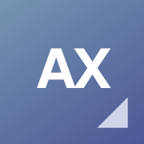
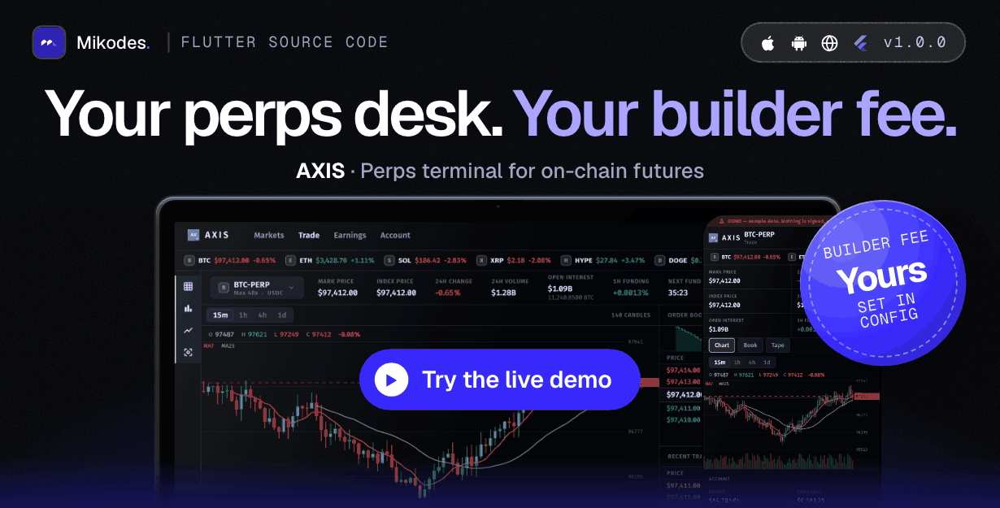
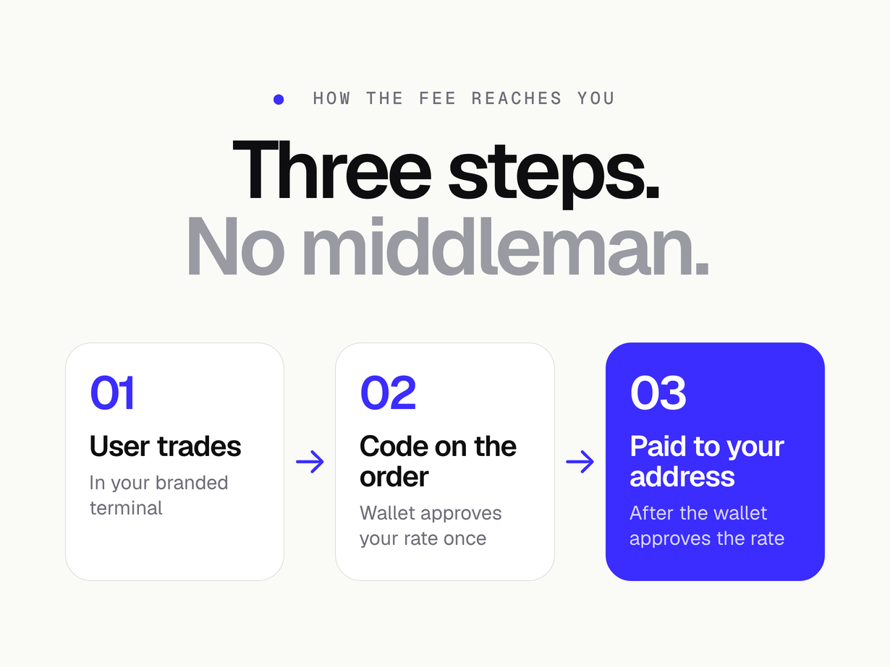
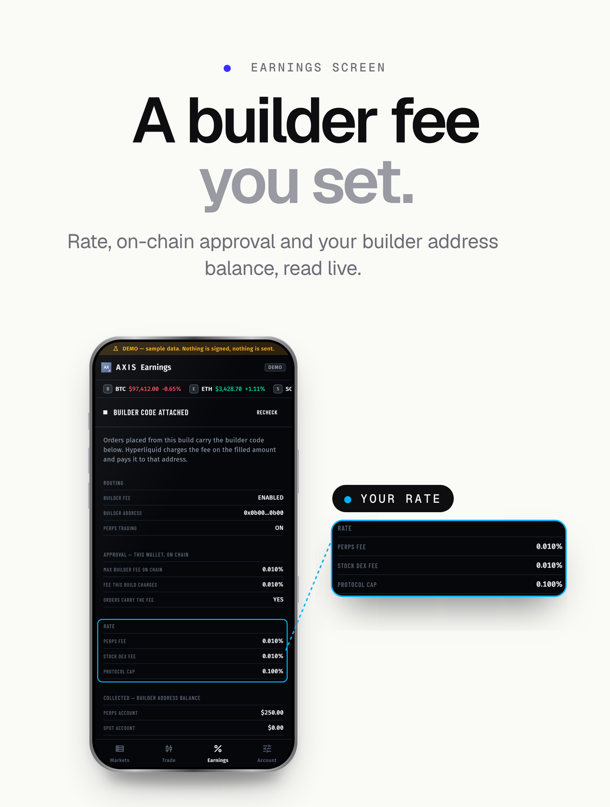
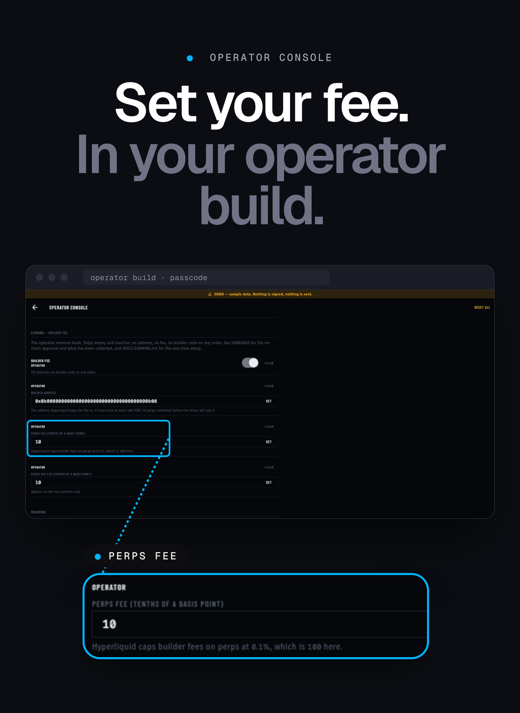
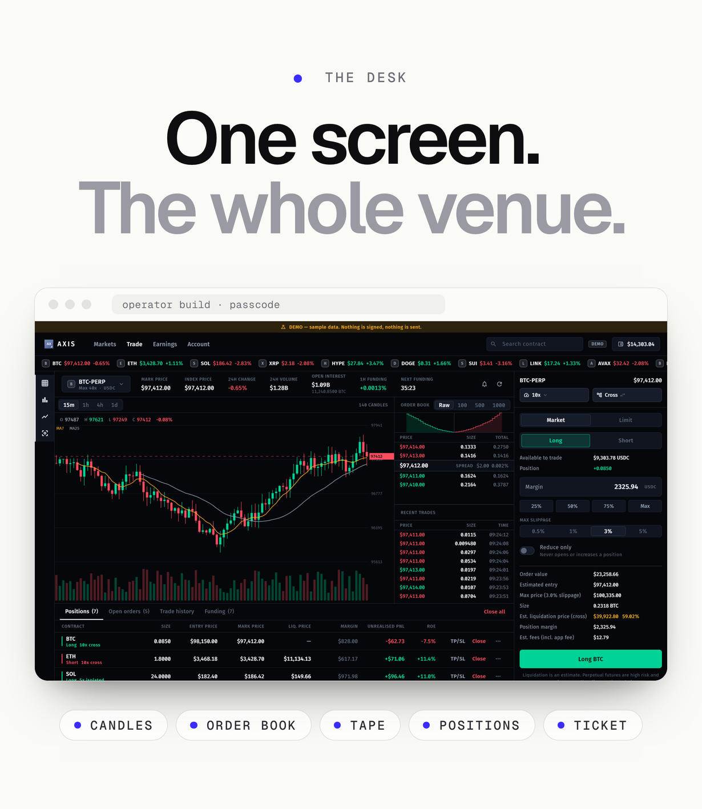
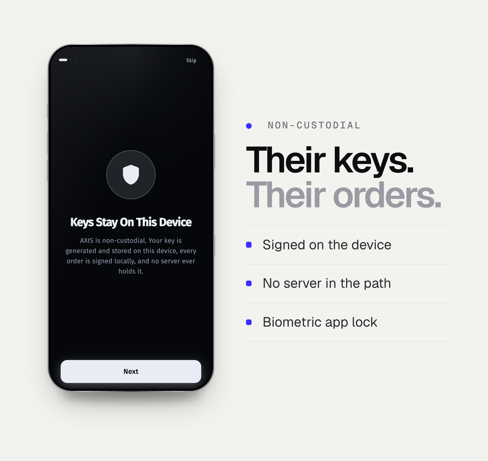

  

<h1 align="center">AXIS</h1>

  <b>Perps terminal: a Flutter app for on-chain futures trading on Hyperliquid.</b>

  <a href="https://axis-demo.mikodes.com/"><b>▶ Live demo</b></a> ·
  <a href="https://axis.mikodes.com/docs/"><b>Docs</b></a> ·
  <a href="https://axis.mikodes.com/"><b>Website</b></a> ·
  <a href="https://store.mikodes.com/p/axis/"><b>Get the full source code</b></a>

  
  
  

  

> **This repository is a showcase.** It holds screenshots, documentation pointers and a real excerpt
> from the code. The full application is sold as source code at
> **[store.mikodes.com/p/axis](https://store.mikodes.com/p/axis/)**: one payment, instant ZIP download, free setup help.

---

## What it is

A mobile trading terminal for Hyperliquid perpetual futures with split and quad chart layouts, order flow and request signing verified against the official SDK test vectors.

## Screens

 

 

 

## Features

- **Hyperliquid perps trading**
- **Signing verified against the Hyperliquid Python SDK golden vectors**
- **Operator builder fee**
- **Operator kill switch for perps**
- **USDC in/out via Arbitrum Bridge2**
- **Non-custodial local signing**
- **WalletConnect sessions**

## How it works

A technical case study of the architecture, one end-to-end flow, the key engineering decisions and how you would build something like this: **[docs/HOW-IT-WORKS.md](docs/HOW-IT-WORKS.md)**.

## A look at the code

Real excerpts from the source, shown for illustration:

- **Phishing URL check** ([`snippets/phishing_detector.dart`](snippets/phishing_detector.dart)): Screens every dApp link before it opens: invalid links and known phishing domains are blocked, and look-alike domains and scam keywords raise a warning.
- **Conservative liquidation estimate** ([`snippets/perps_order_math.dart`](snippets/perps_order_math.dart)): The isolated liquidation price uses the exchange formula with maintenance margin, so it arrives earlier than the naive entry over leverage figure. Unknown inputs give no number instead of a wrong one.
- **Fail-closed operator fee** ([`snippets/builder_fee_guard.dart`](snippets/builder_fee_guard.dart)): The builder fee is attached to an order only when it is on, the address is well formed and the fee is inside the exchange limit. Otherwise the order goes out with no fee instead of failing.

Not included: Hosting and domain; Third-party API subscriptions; Developer accounts; Blockchain network fees.

## Get the full source code

  

One payment, full licence, instant ZIP download and free setup help.
Questions: [mikodes.com/support](https://mikodes.com/support).

---

  Made by <a href="https://mikodes.com"><b>MIKODES</b></a> · <a href="https://github.com/Mikodesteam">more projects</a>

