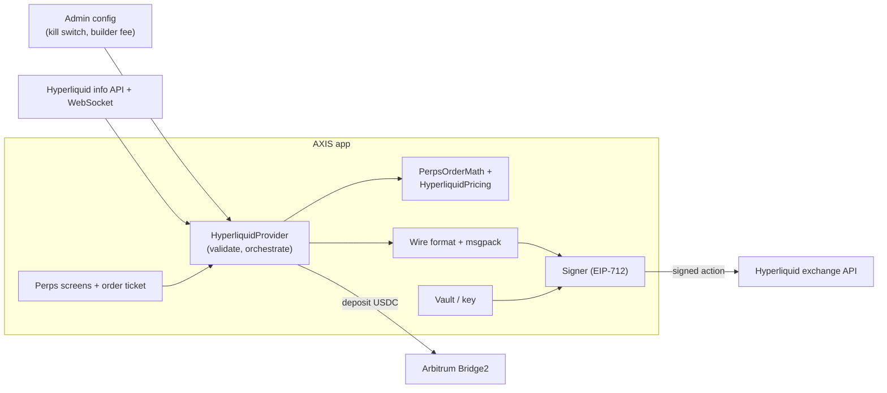

# How AXIS works

A case study of a mobile trading terminal for Hyperliquid perpetual futures, built with Flutter, where
every order is signed on the user's own device. It is written from the real code; short verbatim
excerpts are in [`../snippets/`](../snippets/).

## The problem and who it is for

Hyperliquid is an exchange where you trade from a wallet you control, but its own interface is a web
page, and most mobile experiences either hold the user's key for them or are thin wrappers around a
browser. AXIS is a native terminal: charts in split and quad layouts, an order ticket with leverage and
margin mode, positions, funding USDC in and out, WalletConnect and a dApp browser. It is built for a
team that wants to launch its own branded perps terminal and, if they wish, earn a builder fee on the
volume, without ever holding user funds.

## Architecture

One Flutter app and a small Firebase project. There is no trading server of the operator's own: the app
talks to Hyperliquid's public APIs directly and signs locally.

| Layer | Responsibility |
| --- | --- |
| `core/hyperliquid` | The protocol client: info API (reads), exchange API (signed writes), WebSocket, wire format, msgpack encoder, signer, pricing and order math, funding (Bridge2). |
| `state/hyperliquid_provider` | Application logic: validation, orchestration of leverage and order calls, positions, operator switches. |
| `features/perps` | The screens: markets list, per-market trade screen, order ticket, wallet wiring. |
| Wallet core | Vault, HD wallet, typed-data signer, WalletConnect (Reown), dApp browser with phishing checks. |
| Admin config | Remote operator settings: feature flags, builder fee and address, stocks switch. |

## One flow end to end: placing a market order

1. **The ticket produces a margin and a leverage.** The ticket is margin-driven: the user picks the
   margin they commit and the leverage, and `PerpsOrderMath.sizeCoin` turns that into a size in the
   base asset. It returns zero when there is no live price, so the order is blocked rather than
   guessed.
2. **The provider checks the operator switches.** An order that opens or adds to a position is refused
   when trading (or, for stock-style markets, stocks) has been switched off in the operator settings.
   An order that reduces a position is always allowed, so users can never be trapped in a trade.
3. **A fresh reference price is fetched.** A market order is not sent at a stale mid.
4. **A market order becomes an aggressive limit order.** The pricing helper crosses the book by the
   chosen slippage (3 % by default), and rounds a buy up and a sell down to a valid tick, so rounding
   can only widen the slippage allowance, never erase it (see [`perps_order_math.dart`](../snippets/perps_order_math.dart)
   for the math next to it).
5. **The size is rounded to the market's lot.** Opening orders round down (rounding "Max" up by one lot
   can push the required margin over what is available), while reduce-only orders round to the nearest
   lot.
6. **Pre-flight validation runs before anything is signed.** The size must not round to zero, the price
   must satisfy the exchange rules (at most five significant figures and a limited number of decimals
   depending on the market), and an opening order must clear the exchange's minimum order value,
   measured against the lower of the limit and the reference price.
7. **Leverage is changed only if it must be.** The exchange has no atomic "set leverage and place
   order", so the app sends the leverage update only when it differs from the open position, and never
   for reduce-only orders. If the order then fails after a changed leverage, the user is told.
8. **The action is built in wire form and signed on the device.** Field order and number formatting
   mirror the reference SDK, the action is msgpack encoded and hashed, then signed with EIP-712.
   If the operator builder fee is active, the builder entry is appended as the last key (see
   [`builder_fee_guard.dart`](../snippets/builder_fee_guard.dart)).
9. **The result is parsed.** A timeout is not treated as a rejection: the outcome is unknown, and a
   client order id lets the app look the order up if the response was lost.

## Key engineering decisions

### 1. Byte-exact signing, proven with the reference vectors

- **Chosen:** re-implement the action hashing (including a minimal msgpack encoder) in Dart and test it
  against golden vectors copied from the reference Python SDK.
- **Alternative:** embed a web view or a server-side signer that uses the official SDK.
- **Why:** a server would have to hold the user's key, and a web view would give up the native
  experience. A signature is either byte-exact or rejected, so tests with known answers are the only
  honest proof. Key order, number formatting and msgpack details are all load-bearing.

### 2. Margin-driven order ticket

- **Chosen:** the user commits margin and leverage, the size is derived. "Close 50 %" is expressed by
  writing the margin that yields half the position, so it flows through the same cap, rounding and
  summary as every other size.
- **Alternative:** a second, independent size input.
- **Why:** two inputs that can disagree create bugs. The close margin is rounded up so "100 %" cannot
  leave a dust remainder; overshoot is safe because reduce-only orders are capped at the position.

### 3. Conservative liquidation estimate, or no number at all

- **Chosen:** use the exchange's maintenance-margin formula, which makes liquidation arrive earlier than
  the naive `entry / leverage` figure, and return null when an input is unknown. Cross margin needs live
  account data and returns null without it rather than printing the isolated number.
- **Alternative:** a simple estimate that always shows something.
- **Why:** a wrong liquidation price is worse than none. The leverage picker and the ticket call the same
  function so the two numbers cannot drift apart.

### 4. Fail closed on the operator fee

- **Chosen:** the builder fee is attached only when it is on, the address matches the expected shape and
  the fee is inside the exchange limit; otherwise the order goes out with no builder fee.
- **Alternative:** send whatever the admin configured.
- **Why:** a malformed address or an over-limit fee makes the user's one-time builder approval fail, and
  with it every order. Losing a fee is better than blocking all trading.

### 5. Closing is always allowed

- **Chosen:** the operator kill switch and the stocks switch block only opening orders. Closing and
  withdrawing continue.
- **Alternative:** a global stop that blocks everything.
- **Why:** a kill switch that traps users inside open leveraged positions turns an operational pause into
  a financial loss.

## Security and safety measures that exist in the code

- **Non-custodial local signing.** Every exchange call signs on the device with the caller's key. The
  key is not stored by the API client or sent anywhere, and there is no server-side signing path in the code.
- **Strictly increasing nonces.** Two actions in the same millisecond (a quick double close, or an approval
  plus an order) would share a timestamp, so the nonce is bumped to stay unique inside the accepted window.
- **Request timeout.** An order that stalls does not leave the ticket on "Placing..." forever; the caller
  is told the outcome is unknown.
- **Builder fee approval needs explicit confirmation** on the device, because it grants the operator the
  right to charge up to a maximum rate per trade.
- **Price rules are checked right before signing** as defence in depth, in addition to the rounding.
- **Operator kill switch for perps,** off by default (`hyperliquid_perps_enabled`).
- **Phishing screening for dApp links.** Invalid links and known phishing domains are blocked, look-alike
  domains and scam keywords raise a warning (see [`phishing_detector.dart`](../snippets/phishing_detector.dart)).
- **Re-authentication.** Signing on web asks for the vault passphrase; the wallet wiring passes an
  authentication callback to the perps layer.
- **Demo build cannot sign.** The demo configuration holds an address but only an unusable stub in place of a key.
- **Resilient WebSocket.** One multiplexed connection with pings, a dead-socket timeout, reconnect with
  backoff and replay of all subscriptions.

## Testing approach

- The signer has a test file built on golden vectors from the reference SDK.
- The order math, pricing and validation are pure static functions so they are tested without a UI.
- The provider's validation is exposed to tests, and clocks are injected where timing matters.

## How you would build something like this

1. **Start from the protocol, not the UI.** Read the exchange docs and the reference SDK, and write the
   wire format, encoder and signer first.
2. **Get one signature to match a published vector,** then another. Do not build screens before this passes.
3. **Separate reads from writes.** An info client and a WebSocket for market data, a small exchange client
   for signed actions, with an injectable clock and HTTP client.
4. **Put the arithmetic in pure functions:** size, notional, fees, liquidation, rounding to tick and lot.
   Document the formulas next to the code and test them with known values.
5. **Add a provider layer that validates before signing** and decides what is allowed when the operator
   pauses trading.
6. **Add funding last:** a deposit orchestrator (validate, send, poll until credited) with the wallet's
   send function injected, and withdrawals as a signed action.
7. **Add monetisation as an optional, validated, fail-closed addition** to the action, and keep it empty
   by default.
8. **Ship a demo mode** that cannot sign, so the product can be shown without keys.

## Deployment and customization

- **Backend:** a Firebase project for remote configuration, push and the admin console; the app talks to
  Hyperliquid directly, so you run no trading servers.
- **Operator settings:** perps on or off, stocks markets, builder address and fee, plus the usual
  white-label settings from the admin panel.
- **Customization in code:** chart layouts, themes, markets shown, and any extra screens, in Dart.
- **Not included:** hosting and domain, third-party API subscriptions, developer accounts and blockchain
  network fees.

Full source code, docs and setup help: https://store.mikodes.com/p/axis/
